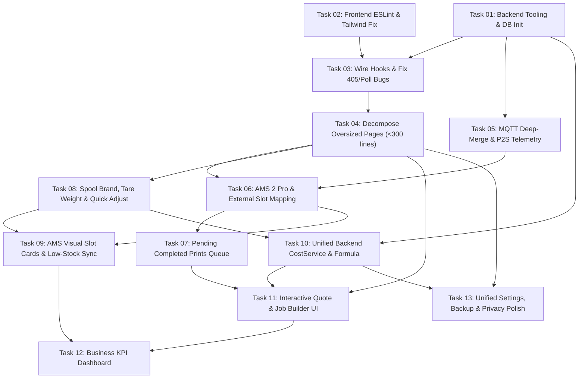

# 3D Business Management App — Master Roadmap & Task Breakdown Index

This directory contains the complete, vertical-slice implementation plan and Test-Driven Development (TDD) task breakdown for Phase 1 of the **3D Printing Business Management Application**, structured according to `/planning-and-task-breakdown`.

---

## 📂 Directory Structure

- **[plan.md](./plan.md)** — Master Implementation Plan: Architecture decisions, dependency graph, TDD workflow contract, risks & mitigations, and open questions.
- **[todo.md](./todo.md)** — Master Checklist: Ordered task list with verification checkpoints across all 5 phases.
- **[01-foundation-and-bugfixes/](./01-foundation-and-bugfixes/README.md)** — Tooling gates, CSS/Tailwind fixes, wiring dead hooks/components, fixing HTTP 405 & offline bugs, and decomposing oversized files (<300 lines).
  - [Task 01: Backend Tooling, Config Unification & DB Lifecycle](./01-foundation-and-bugfixes/task-01-backend-tooling-and-db-init.md)
  - [Task 02: Frontend ESLint Rules, Zero Suppressions & Tailwind Theme Fix](./01-foundation-and-bugfixes/task-02-frontend-lint-and-css-theme.md)
  - [Task 03: Wire Frontend API & React Query Hooks (Fix Filament 405 & Printer Poll)](./01-foundation-and-bugfixes/task-03-wire-modular-hooks-and-apis.md)
  - [Task 04: Decompose Oversized Pages (`Printer.tsx`, `Jobs.tsx`, `StockSettings.tsx`)](./01-foundation-and-bugfixes/task-04-decompose-oversized-pages.md)
- **[02-bambu-p2s-and-ams2-pro-sync/](./02-bambu-p2s-and-ams2-pro-sync/README.md)** — Deep-merge MQTT telemetry for Bambu Lab P2S, virtual AMS 2 Pro & External Spool mapping for third-party filaments, and Pending Completed Prints queue.
  - [Task 05: MQTT Deep-Merge Telemetry, P2S Chamber Temp & Credential Masking](./02-bambu-p2s-and-ams2-pro-sync/task-05-mqtt-deep-merge-and-p2s-telemetry.md)
  - [Task 06: AMS 2 Pro & External Spool Slot Assignment for Non-Bambu Filaments](./02-bambu-p2s-and-ams2-pro-sync/task-06-ams2-pro-and-external-slot-assignment.md)
  - [Task 07: Pending Completed Prints Review Queue (`RUNNING` -> `FINISH`)](./02-bambu-p2s-and-ams2-pro-sync/task-07-pending-completed-prints-queue.md)
- **[03-inventory-and-stock-control/](./03-inventory-and-stock-control/README.md)** — Manual stock control ergonomics for non-Bambu spools: brand, initial/empty spool tare weight calculator, quick adjustments, and AMS color/stock sync.
  - [Task 08: Spool Brand, Tare Weight Calculator & Quick Gram Adjustments](./03-inventory-and-stock-control/task-08-spool-brand-weight-and-taring.md)
  - [Task 09: AMS 2 Pro Visual Slot Cards, Color Match & Low-Stock Alerts](./03-inventory-and-stock-control/task-09-ams-color-and-low-stock-sync.md)
- **[04-cost-and-pricing-engine/](./04-cost-and-pricing-engine/README.md)** — Unified backend/frontend pricing engine (Filament + Electricity + Machine Wear + Failure Rate + Markup + Custom Costs) and interactive quote builder.
  - [Task 10: Unified Backend `CostService` & Configurable Pricing Formula](./04-cost-and-pricing-engine/task-10-unified-backend-cost-service.md)
  - [Task 11: Interactive Cost & Quote Calculator UI + Model Library & Printer Linking](./04-cost-and-pricing-engine/task-11-interactive-quote-and-job-builder.md)
- **[05-business-dashboard-and-settings/](./05-business-dashboard-and-settings/README.md)** — Executive business KPIs, workshop floor overview, unified settings page, local DB backup/export, and Privacy Mode coverage for demos/marketing.
  - [Task 12: Business KPI Dashboard (Revenue, Cost, Profit, AMS & Pending Prints)](./05-business-dashboard-and-settings/task-12-business-kpi-dashboard.md)
  - [Task 13: Unified Tabbed Settings, Local Backup/Export & Privacy Mode Polish](./05-business-dashboard-and-settings/task-13-unified-settings-and-backup.md)

---

## 🔗 System Dependency Graph

---

## 🛡️ Standing Definition of Done (Every Task)

Every single task in this roadmap must satisfy the following gates before it is marked complete:

1. **Strict TDD Loop (Red -> Green -> Refactor)**:
   - Write failing unit/integration test cases (including edge cases) **first**.
   - Run the test suite to prove the test fails for the expected reason.
   - Implement the minimal, clean code to make the test pass.
   - Refactor for SOLID, DRY, KISS, and readability.
2. **Backend Quality Gates (Zero Errors, Zero Warnings, Zero Ignores)**:
   - `rtk uv run --directory backend ruff check .`
   - `rtk uv run --directory backend ruff format --check .`
   - `rtk uv run --directory backend ty check`
   - `rtk uv run --directory backend pytest`
3. **Frontend Quality Gates (Zero Errors, Zero Warnings, Zero Ignores)**:
   - `rtk bun run --cwd frontend lint` (enforcing `max-lines: 300`, `max-lines-per-function: 100`, `complexity: 15`)
   - `rtk bun run --cwd frontend tsc --noEmit`
   - `rtk bun run --cwd frontend build`
   - `rtk bun run --cwd frontend test -- --run`
4. **Privacy Mode Compatibility**:
   - Every new financial, credential, or business metric UI element is wrapped in `<PrivacyWrapper>` so screen shares and marketing demos remain 100% leak-free.
